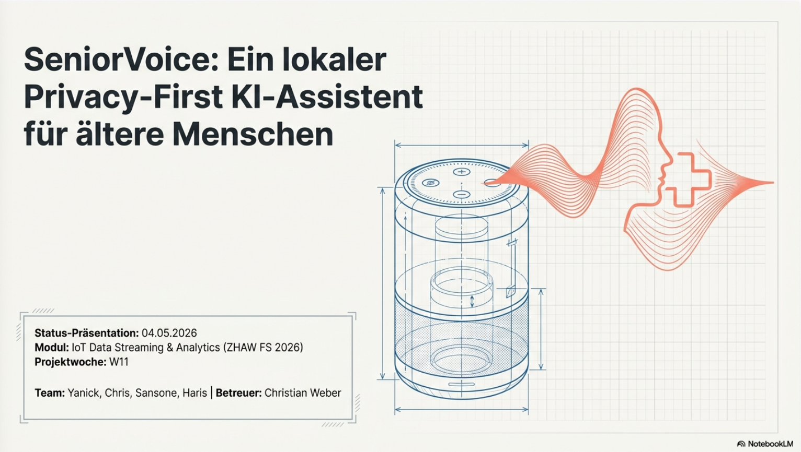

# SeniorVoice
**Lokaler KI-Sprachassistent für ältere Personen**
ZHAW IoT Data Streaming & Analytics · FS 2026
Team: Yanick · Teammitglied 3 · Teammitglied 1 · Teammitglied 2

[](docs/SeniorVoice_Local_AI_for_Seniors.pdf)
> Klick auf das Bild öffnet die Zwischenstand-Präsentation (W11, 04.05.2026)

---

## Inhaltsverzeichnis

- [Repo-Struktur](#repo-struktur)
- [Was ist SeniorVoice?](#was-ist-seniorvoice)
- [Aktueller Stand](#aktueller-stand)
- [Hardware](#hardware)
- [Für neue Teammitglieder](#für-neue-teammitglieder)

> **Abschlussdokumentation:** [`docs/Projektdokumentation.md`](docs/Projektdokumentation.md) — konsolidierte Zusammenfassung (Architektur, Benchmark-Ergebnisse, Lessons Learned, Kosten). Detaillierte Logs aller Sessions: [`docs/logs/`](docs/logs/)

---

## Repo-Struktur

```
seniorvoice/
├── pipeline/                    # MVP Code (aktiv, end-to-end funktional)
│   ├── main.py                  # Orchestrator
│   ├── audio_capture.py         # Mic-Aufnahme + Silence-Detection
│   ├── stt.py                   # faster-whisper Transkription
│   ├── llm_client.py            # Chat-Interface (streaming + non-streaming)
│   ├── llm_backend.py           # LLM-Abstraktionsschicht (Fallback-Chain)
│   ├── tts.py                   # Piper TTS + Playback
│   ├── memory.py                # Long-Term Memory (SQLite)
│   ├── sensor.py                # PIR GPIO4
│   ├── sounds.py                # Audio-Feedback Chimes
│   ├── config.py                # Env-Var Konfiguration
│   ├── logging_config.py        # Structured Logging
│   ├── interaction_log.py       # SQLite Interaction Logger
│   ├── benchmark_models.py      # LLM-Benchmark CLI-Tool
│   └── requirements.txt
├── services/                    # Microservice-Skeletons (inaktiv)
│   ├── stt-service/
│   ├── llm-service/
│   ├── action-service/
│   ├── tts-service/
│   └── logger-dashboard/
├── docs/
│   ├── models/                  # Benchmark-Ergebnisse + JSON-Rohdaten
│   ├── logs/                    # Arbeitsprotokolle pro Session
│   ├── hardware/                # Datenblätter (PDF)
│   └── projektantrag.md         # Projektantrag
├── CONTEXT.md                   # Aktueller Projektstand
└── CLAUDE.md                    # Coding-Regeln für Claude Code
```

---

## Was ist SeniorVoice?

SeniorVoice ist ein vollständig lokaler, datenschutzkonformer KI-Sprachassistent auf Raspberry Pi 5. Er hilft älteren Personen (65+) bei Alltagsfragen — ohne Smartphone, ohne Cloud, ohne technisches Vorwissen.

### Das Problem

Ältere Menschen sind zunehmend mit digitalen Prozessen konfrontiert (Online-Terminbuchung, Apps, Portale), haben aber weder die Geräte noch die digitale Kompetenz dafür. Bestehende Sprachassistenten wie Alexa oder Siri sind cloudbasiert, datenschutzkritisch und nicht für Senioren konzipiert.

### Die Lösung

Ein eigenständiges Gerät, das auf Bewegung reagiert, auf Deutsch zuhört, versteht und antwortet — vollständig lokal auf dem Raspberry Pi verarbeitet. Keine Daten verlassen das Gerät.

```
PIR-Sensor → Mikrofon → STT → LLM → TTS → Lautsprecher
                         │              │
                    Transkript      Antwort (DE)
                         └──────────────┘
                           SQLite + Grafana
```

### Kernprinzipien

- **Privacy by Design** — alle Verarbeitung on-device, kein Cloud-Upload
- **Kein Smartphone nötig** — standalone Gerät, Sprachsteuerung
- **Deutsch** — optimiert für Hochdeutsch, warmherziger Ton
- **Einfach** — klare, ruhige Antworten für nicht-technikaffine Nutzer

---

## Aktueller Stand

> **W23 (28.06.2026)** — Projekabschluss: MVP vollständig deployed, Performance-Tuning abgeschlossen, Grafana-Dashboard live, Abgabe eingereicht

### Präsentationen

- [SeniorVoice_Local_AI_for_Seniors.pdf](docs/SeniorVoice_Local_AI_for_Seniors.pdf) — Zwischenpräsentation W11 (04.05.2026)
- [SeniorVoice_Praesentation.pdf](docs/SeniorVoice_Praesentation.pdf) — Abschlusspräsentation W23 (29.06.2026)

### Pipeline (funktional)

```
PIR-Sensor (HC-SR501) → C920E Mikrofon → faster-whisper STT → Ollama LLM → Piper TTS → Sony BT-Speaker
```

### Tech Stack

| Komponente | Technologie | Details |
|---|---|---|
| Hardware | Raspberry Pi 5 (16 GB) | NVMe SSD (Crucial P310), headless |
| STT | faster-whisper (small, int8) | Lokale Transkription, CPU-only |
| LLM (lokal) | Ollama — gemma3:1b | **10.4 tok/s**, 698ms TTFT (nach Tuning), Q4_K_M |
| LLM (Cloud-Fallback) | Moonshot Kimi k2.6 | 6.0 tok/s, aber 11.7s TTFT |
| TTS | Piper TTS (de_DE-thorsten-medium) | Lokale Sprachsynthese |
| Audio | PulseAudio | USB-Mic → BT-Speaker Routing |
| Sensor | PIR HC-SR501 (GPIO4) | Bewegungserkennung als Trigger |
| Storage | SQLite (WAL mode) | Long-Term Memory + Interaction Logs |
| Python | 3.13 | venv mit --system-site-packages |

### LLM-Benchmark (12 Modelle getestet)

Vollständige Ergebnisse: [model_comparisson.md](docs/models/model_comparisson.md)

| Model | Type | tok/s | TTFT | German | Status |
|---|---|---|---|---|---|
| gemma3:1b (tuned) | Local | **10.4** | 698ms | Acceptable | **Produktion** |
| gemma3:1b (baseline) | Local | 3.8 | 1.3s | Acceptable | Ausgangswert |
| gemma3n:e2b | Local | 2.4 | 2.3s | Good | Kandidat |
| kimi-k2.6 | Cloud | 6.0 | 11.7s | Excellent | Zu langsam (TTFT) |
| gemma3:4b | Local | 1.7 | 2.5s | Excellent | Zu langsam |

**Schlüsselresultat:** 3.8 → 10.4 tok/s (+174%) durch Overclock 2.8 GHz + num_thread=3 Optimierung. Vollständige Benchmark-Ergebnisse: [`docs/Projektdokumentation.md`](docs/Projektdokumentation.md)

### Features (über MVP hinaus)

- **Streaming + per-sentence TTS** — Antwort wird satzweise vorgelesen während LLM weiter generiert
- **Session Memory** — Multi-Turn-Konversation mit 5-Minuten-Timeout
- **Long-Term Memory** — SQLite-basiert, merkt sich Fakten über Benutzer
- **Audio-Feedback** — Chimes signalisieren "höre zu" / "denke nach"
- **LLM-Fallback-Chain** — Ollama → Kimi, konfigurierbar via Env-Vars
- **Structured Logging** — RotatingFileHandler (5 MB × 5 Backups)
- **Interaction Logs** — Timing-Daten (STT/LLM/TTS) in SQLite, Grafana-ready

### Abgeschlossen (W11–W23)

- ✓ Performance-Tuning: 2.8 GHz Overclock + num_thread=3 → 10.4 tok/s (+174%)
- ✓ CPU Governor `performance` via systemd-Unit (Autostart beim Boot)
- ✓ Grafana 11.6.0 Dashboard (5 Panels, frser-sqlite-datasource v4.0.2)
- ✓ Facts Re-Injection: Nutzermerkmale vor jeder Anfrage eingefügt
- ✓ LLM Warmup bei Startup: eliminiert Cold-Start-Latenz
- ✗ Docker-Compose / Microservice-Split: nicht implementiert (Scope-Entscheidung D-06)

---

## Hardware

> Vollständige Kostenzusammenfassung und alle Rechnungsdetails: [docs/hardware/Hardware-Beschaffung.pdf](docs/hardware/Hardware-Beschaffung.pdf)

### Benötigte Komponenten (Prototyp-Nachbau)

| Menge | Artikel | Preis CHF |
|------:|---------|----------:|
| 1 | HutoPi Raspberry Pi 5 Starter Kit – 16 GB | 249.00 |
| 1 | Raspberry Pi Official Fan/Heat Sink for Pi 5 | 9.50 |
| 1 | Raspberry Pi Official M.2 HAT+ Compact | 15.70 |
| 1 | Crucial P310 PCIe 4.0 NVMe 2230 M.2 SSD 1 TB | 132.98 |
| 1 | KKSB Gehäuse für Raspberry Pi 5 + HATs, Alu, schwarz | 16.31 |
| 1 | Raspberry Pi Infrarot Bewegungsmelder PIR HC-SR501 | 1.94 |
| 1 | Jumperkabel Dupont Set (60 Stk., für GPIO-Verdrahtung) | ~15.00 |
| | **Summe Beschaffung (ohne bereits vorhandene Geräte)** | **~440 CHF** |

**Bereits vorhanden (nicht beschafft, kein Kostenanteil):**
- Logitech C920E Webcam — als USB-Mikrofon verwendet
- Sony SRS-XB23 Bluetooth-Lautsprecher — als Audioausgabe verwendet

### Hinweis zur Reproduzierbarkeit

Der Prototyp läuft vollständig headless auf dem Raspberry Pi 5 (NVMe-SSD-Boot, PulseAudio, Python 3.13 venv). Für einen Nachbau werden kein Bildschirm und keine Tastatur benötigt — SSH-Zugang genügt. Der PIR-Sensor (HC-SR501) ist über GPIO17 (Pin 11) angeschlossen; alternativ kann `--no-pir` als Startoption genutzt werden, um Keyboard-Triggering zu aktivieren.

---

## Für neue Teammitglieder

### 1 — Voraussetzungen

- Python 3.13+
- Git
- SSH-Zugang zum Raspberry Pi (Yanick kontaktieren für Key-Setup)

### 2 — Repo klonen

```bash
git clone https://github.com/yanickfischer/seniorvoice.git
cd seniorvoice
```

### 3 — Branching-Strategie

| Branch | Zweck |
|---|---|
| `main` | Stabiler Stand — nur via Pull Request |
| `dev` | Aktiver Entwicklungszweig |
| `feature/[name]` | Pro Feature (z.B. `feature/stt-service`) |

```bash
git checkout dev
git pull
git checkout -b feature/dein-feature
```

### 4 — Commit-Konvention

| Prefix | Wann |
|---|---|
| `feat:` | Neue Funktionalität |
| `fix:` | Bugfix |
| `chore:` | Setup, Konfiguration, Dokumentation |
| `test:` | Tests hinzufügen oder anpassen |
| `refactor:` | Umstrukturierung ohne Funktionsänderung |

### 5 — SSH-Zugang zum Raspberry Pi

Der Pi läuft headless auf `<PI_IP>`. Zugang nur via SSH Key-Auth.

```bash
# Key generieren (einmalig)
ssh-keygen -t ed25519 -C "deinname@seniorvoice"

# Public Key an Yanick schicken
cat ~/.ssh/id_ed25519.pub

# Verbinden (nachdem Key hinzugefügt wurde)
ssh deinname@<PI_IP>
```

### 6 — Deploy-Workflow

Code wird auf Mac/PC editiert und via `scp` auf den Pi deployed:

```bash
# Mac → Pi (geänderte Dateien)
scp pipeline/datei.py yanick@<PI_IP>:/tmp/

# Pi (deployen + starten)
sudo cp /tmp/*.py /home/admin/seniorvoice/pipeline/
cd ~/seniorvoice/pipeline
source ../.venv/bin/activate
export LLM_API_KEY=<key>
python main.py --no-pir --once
```

### 7 — Projektdokumentation

| Datei | Inhalt |
|---|---|
| **`docs/Projektdokumentation.md`** | **Abschlussdokumentation (konsolidierte Kurzfassung)** |
| `docs/logs/` | Chronologische Arbeitsprotokolle pro Session (14 Einträge, März–Juni 2026) |
| `CONTEXT.md` (Root) | Aktueller Projektstand, Hardware, technische Entscheide (D-01–D-50) |
| `CLAUDE.md` (Root) | Architektur-Regeln, Coding-Konventionen |
| `docs/projektantrag.md` | Vollständiger Projektantrag (Scope, Timeline) |
| `docs/models/model_comparisson.md` | LLM-Benchmark-Ergebnisse |
| `docs/hardware/Hardware-Beschaffung.pdf` | Hardware-Kostenübersicht (CHF 895.42) |

---

*ZHAW FS 2026 · IoT Data Streaming & Analytics · Team SeniorVoice*
