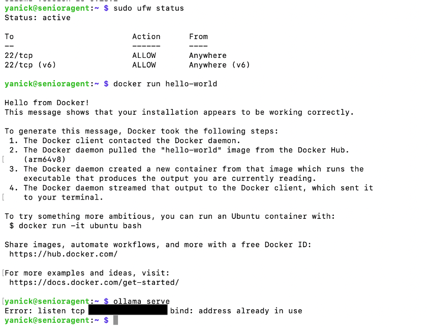

# Log Entry 001 · W05 · Pi Setup, Security Hardening & Repo Setup

**Meta-Informationen**

| Feld | Wert |
|---|---|
| Datum | 19.–20.03.2026 |
| Projektwoche | W05 |
| Autor | Yanick |
| Dauer | ca. 6–7 Stunden |
| Action-IDs (RAID) | A-01, A-02 (teilweise) |
| GitHub Referenz | github.com/yanickfischer/seniorvoice — Initial Commit |
| Status | Abgeschlossen (mit offenen Folgeschritten) |

---

## 1 · Ziel dieses Schritts

Gemäss Projektplan W05 (Modul 0 — Infrastruktur & Setup) wurde der Raspberry Pi 5 (16 GB) als Entwicklungsgerät in Betrieb genommen. Ziel war ein vollständig headless, remote-zugängliches und gehärtetes System als Grundlage für alle nachfolgenden Microservice-Entwicklungen. Docker und Ollama wurden vorinstalliert, um W06/W07 zu entlasten. Zusätzlich wurde das GitHub-Repository aufgesetzt und eine vollständige Projektdokumentationsstruktur für kollaboratives, Claude-gestütztes Arbeiten etabliert.

---

## 2 · Durchgeführte Aktivitäten

- Raspberry Pi 5 (16 GB) headless mit Raspberry Pi Imager aufgesetzt (SSH, WiFi CH, Europe/Zurich, Hostname `senioragent`)
- AI Hat+ physisch installiert (Evaluation für Whisper-Acceleration)
- Pi Connect eingerichtet und mit Yanick-Account verknüpft (Remote-Display-Zugriff)
- Netzwerksicherheit evaluiert und konfiguriert:
  - Guest-WiFi-Isolation versucht → Salt Fiber Box unterstützt kein Port-Forwarding auf Guest-Subnet (`192.168.254.x`) → Pi zurück auf Haupt-LAN (`<PI_IP>`)
  - IPv6-only Anschluss bei Salt bestätigt → kein externer SSH via Port-Forwarding möglich
  - UFW aktiviert: Default deny incoming, Port 22 TCP erlaubt
  - Docker UFW-Bypass deaktiviert (`"iptables": false` in `/etc/docker/daemon.json`)
- Benutzerverwaltung gehärtet:
  - Benutzer `yanick`, `user1`, `user2`, `user3` erstellt (alle mit sudo)
  - Default-User `admin` gesperrt (`passwd -l admin`)
  - `PermitRootLogin no` in `/etc/ssh/sshd_config` gesetzt
- SSH Key-Auth für `yanick` eingerichtet und getestet (`<PI_IP>`)
- Locale-Fehler behoben (`en_GB.UTF-8`)
- Docker Engine 29.3.0 installiert (via `get.docker.com`)
  - Alle 4 Benutzer zur `docker`-Gruppe hinzugefügt
  - `hello-world` Container erfolgreich ausgeführt (arm64)
- Ollama 0.18.2 installiert (via `ollama.com/install.sh`)
  - Läuft on-demand via `ollama serve &` (kein systemd-Service — ressourcenschonend)
  - Gebunden an `127.0.0.1:11434` — nicht öffentlich erreichbar
- GitHub Repository erstellt: `github.com/yanickfischer/seniorvoice`
  - Ordnerstruktur angelegt: `services/`, `data/sqlite/`, `data/grafana/`, `docs/`, `logs/`
  - `.venv` eingerichtet (Python 3.11), `.gitignore` konfiguriert
- Projektdokumentationsstruktur in `docs/` etabliert:
  - `docs/projektantrag.md` — vollständiger Projektantrag als Markdown
  - `docs/workpackages.md` — lebendige Aufgabenliste mit Statustracking
  - `docs/prompt_master.md` — wiederverwendbarer Claude-Initialisierungsprompt
  - `docs/ssh_access_guide.md` — SSH-Einrichtungsguide für das Team
- `README.md` erstellt mit Projektbeschreibung und Team-Onboarding-Anleitung

---

## 3 · Technische Entscheide

| Entscheid | Begründung | Verknüpfung RAID |
|---|---|---|
| Pi bleibt auf Haupt-LAN statt Guest-WiFi | Salt Fiber Box unterstützt kein Port-Forwarding auf Guest-Subnet; UFW + Key-Auth bieten ausreichende Härtung für Entwicklungsphase | D-01 |
| Kein systemd-Service für Ollama | On-demand Start spart RAM beim Boot; Pi 5 Ressourcen für Docker-Services reserviert | D-02 |
| Docker `iptables: false` | Docker umgeht standardmässig UFW — kritische Härtung vor erstem Container-Deployment | D-03 |
| SSH-Zugang für externes Team via Uni IoT-Netz | Salt liefert IPv6-only → kein externer SSH möglich; Uni-Netz mit Prof. klären | D-04 |
| Venv statt globale Python-Installation | Saubere Abhängigkeitsisolation; keine Konflikte mit Base-Distribution | D-05 |
| Arbeitsprotokoll als Markdown in GitHub statt Word | Versioniert, direkt von Claude im IDE lesbar, für alle Teammitglieder zugänglich ohne Dateiaustausch | D-06 |

---

## 4 · Probleme & Lösungen

| Problem | Lösung / Workaround | Issue-ID (RAID) |
|---|---|---|
| `127.0.1.1` als Pi-IP angezeigt | Loopback-Adresse — echte IP via `ip addr show wlan0` ermittelt | — |
| Guest-WiFi Port-Forwarding schlägt fehl | Salt Fiber Box lehnt `192.168.254.x` als Ziel ab → Pi zurück auf Haupt-LAN | I-01 |
| Salt liefert IPv6-only | Kein IPv4 für Port-Forwarding verfügbar → externer SSH blockiert | I-02 |
| Ollama systemd-Service nicht erstellt | Install-Script erstellt keinen Service → manueller Start via `ollama serve &` | — |
| SSH-Befehlskette auf einmal eingefügt | Shell interpretierte alles als eine Zeile → Befehle einzeln ausgeführt | — |
| Locale-Warnung beim SSH-Login | `sudo update-locale LC_ALL=en_GB.UTF-8` — nur `en_GB` auf diesem Image verfügbar | — |
| Docker-Installation dauerte 20+ Minuten | Pi WiFi-Modul langsam bei grossen Downloads → Ethernet für künftige Downloads empfohlen | — |

---

## 5 · Ergebnis / Lieferobjekte

- Raspberry Pi 5 headless, SSH-zugänglich auf `<PI_IP>`
- 4 Benutzerkonten angelegt, `admin` gesperrt, Root-Login deaktiviert
- UFW aktiv, Docker UFW-Bypass behoben
- Docker Engine 29.3.0 lauffähig (arm64), `hello-world` verifiziert
- Ollama 0.18.2 on-demand startbar, gebunden an `127.0.0.1:11434`
- GitHub Repo mit vollständiger Ordnerstruktur und `docs/` + `logs/`
- `README.md` mit Projektbeschreibung und Onboarding

---

## 6 · Nächste Schritte

- `docker-compose.yml` Skeleton für alle 5 Services (A-02)
- Branching-Strategie anlegen: `main` / `dev` / `feature/*` (A-03)
- `llama3.2:3b` auf Pi pullen + Antwortzeit messen (A-04)
- SSH-Keys von Teammitglied 1, Teammitglied 2, Teammitglied 3 einsammeln (A-05)
- Externer SSH via Uni IoT-Netz mit Prof. klären (A-06)

---

## 7 · Screenshots / Anhänge

