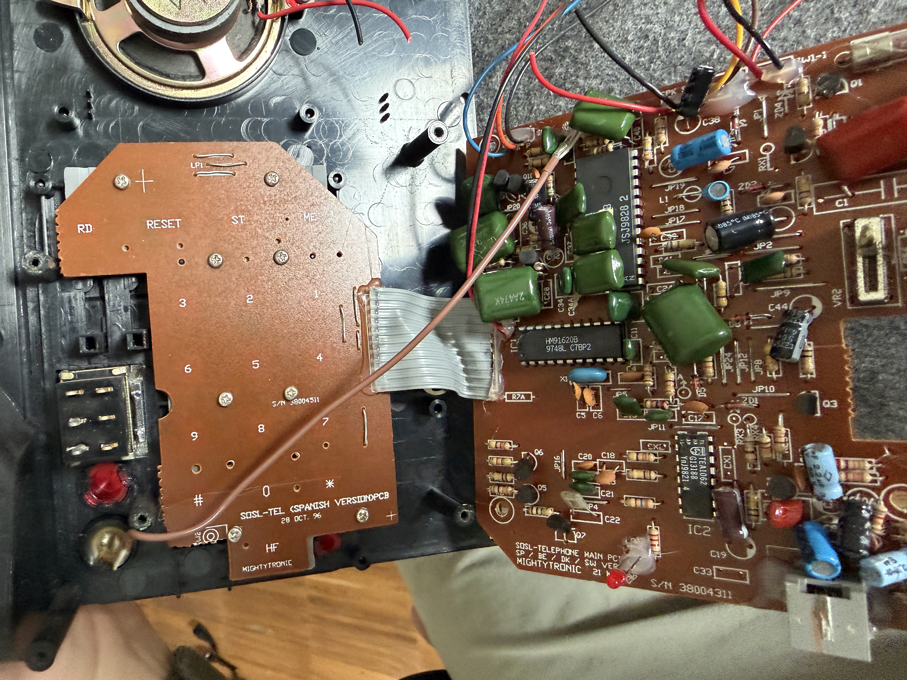
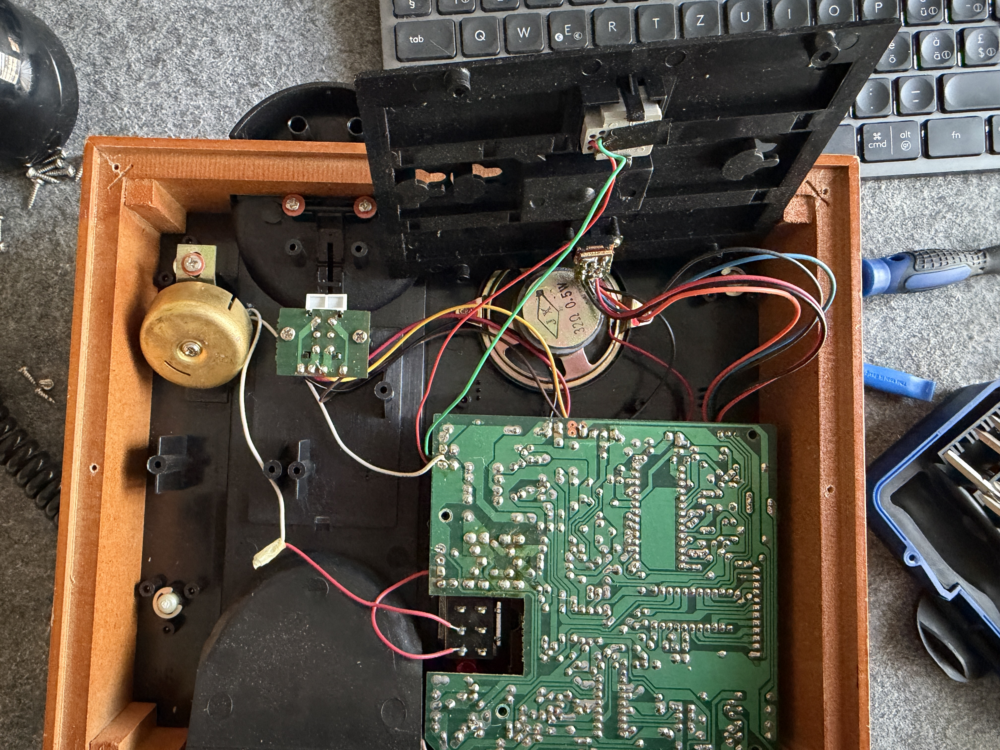
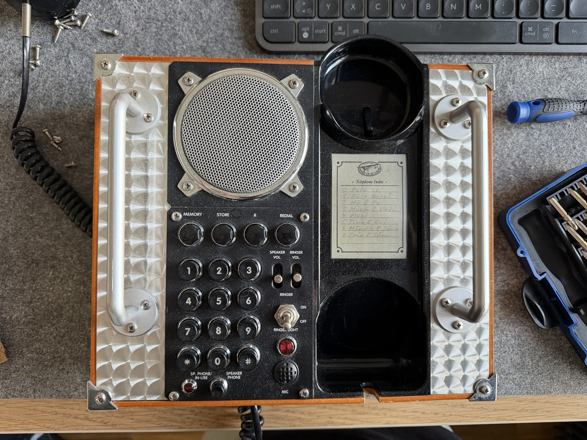
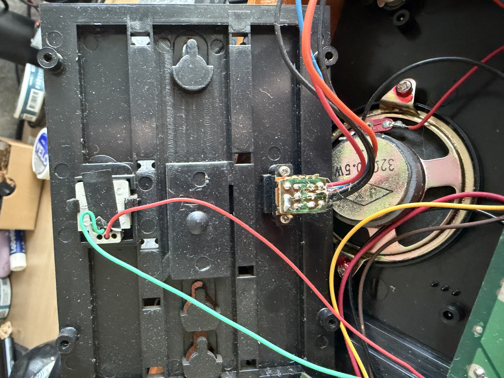
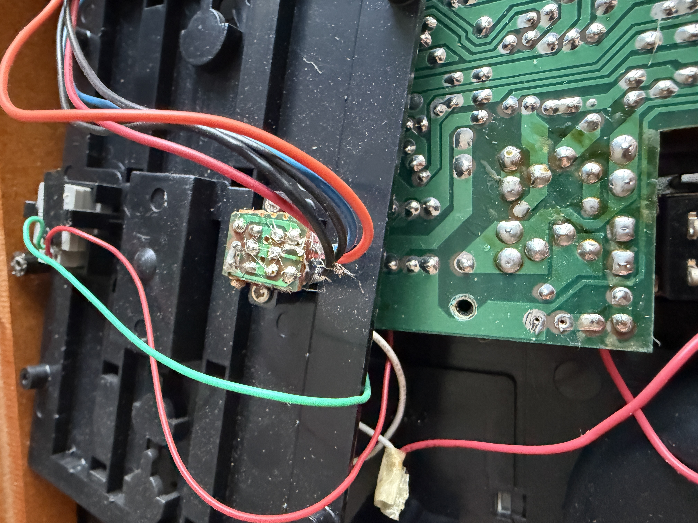
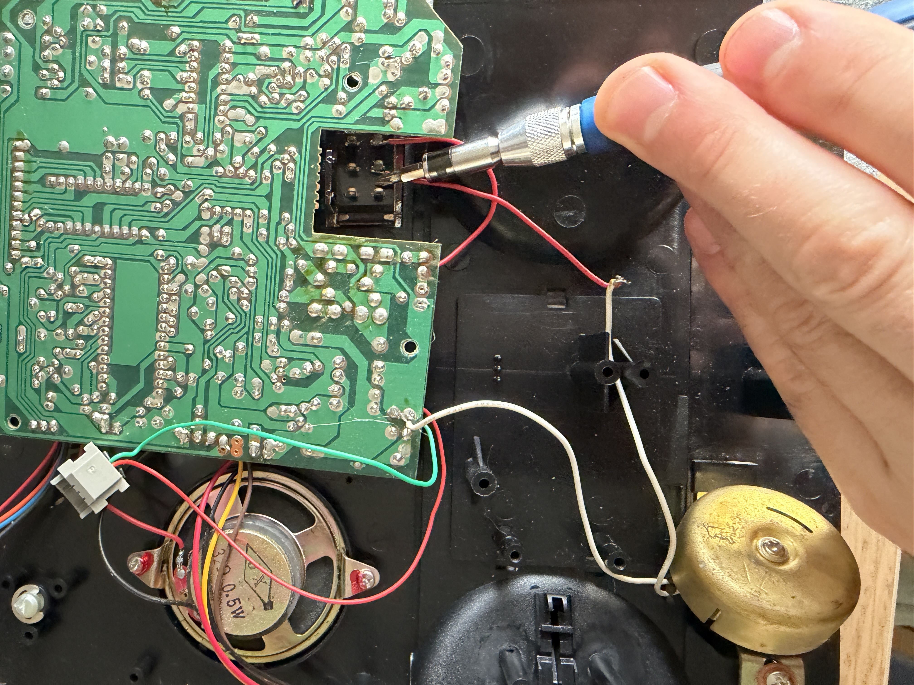
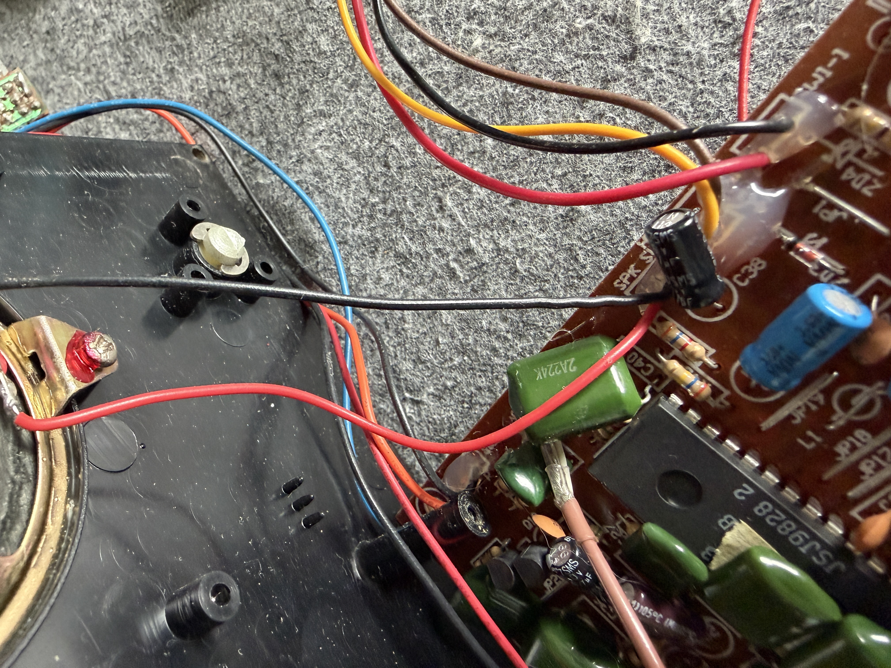

# Log Entry 013 · Abschluss-Planung: Analogtelefon-Interface (geplant, nicht umgesetzt)

**Meta-Informationen**

| Feld | Wert |
|---|---|
| Datum | 27.06.2026 |
| Projektwoche | W22 (Präsentationsvorbereitung) |
| Autor | Yanick |
| Dauer | 1 Stunde (Konzept & Dokumentation) |
| Action-IDs (RAID) | — |
| GitHub Referenz | — |
| Status | Konzept dokumentiert — Implementierung nicht abgeschlossen |

---

## 1 · Ziel dieses Schritts

Als letzten Hardware-Erweiterungsschritt des SeniorVoice-Projekts war geplant, ein **analoges Telefon** (mit zwei Mikrofonen, zwei Lautsprechern, Hörer-Lautstärkeregler, Tastenfeld und weiteren Bedienelementen) als physische Benutzeroberfläche für den SeniorAgent zu integrieren. Das Analogtelefon hätte die bisher verwendete USB-Webcam (Logitech C920E) und den Bluetooth-Lautsprecher (Sony SRS-XB23) als Audio-Interface ersetzt und wäre besonders seniorengerecht gewesen — ein vertrautes Gerät mit klarer Bedienlogik (Hörer abnehmen = sprechen).

Da weder die nötige Zeit noch alle Hardwarekomponenten zur Verfügung standen, wurde dieser Schritt nicht realisiert. Das Konzept, die geplante Architektur und eine vollständige technische Anleitung zur Umsetzung sind in `docs/how-to_analog-telephone.md` dokumentiert.

---

## 2 · Warum wurde dieser Schritt nicht abgeschlossen?

### Zeitliche Gründe

Das Projekt befand sich in der Endphase (Präsentation in 2 Tagen). Die verbleibende Zeit wurde für:
- Verifikation der bestehenden Pipeline (Kimi-API-Test, Log-Vollständigkeit)
- Erstellung der Präsentationsunterlagen

...priorisiert. Ein Hardware-Umbau mit Lötarbeiten, Verkabelung und Software-Anpassungen hätte den Zeitrahmen überschritten.

### Hardware-Gründe

Für die vollständige Umsetzung wären folgende Komponenten benötigt worden (nicht alle vorhanden):
- Analogtelefon mit bekannter interner Schaltung (zum Öffnen geeignet)
- USB-Audio-Adapter (für Hörermikrofon → Pi)
- Arduino Nano/Pro Micro (für Tastenfeld und Potentiometer)
- Lötstation + Lötdraht, Dupont-Kabel, Isolierband
- Kleines Verstärkermodul (PAM8403, 3W) für Hörermuschel

---

## 3 · Geplante Architektur (Kurzübersicht)

```
Analogtelefon
├── Gabel-Schalter (Hook Switch) ──────────────── GPIO Pi 5 (Trigger)
├── Hörer-Mikrofon ──── USB-Audio-Adapter ──────── Pi 5 Mic-Input
├── Hörer-Muschel ────── Verstärker (PAM8403) ──── Pi 5 Audio-Out
├── Freisprecher-Mic (optional) ── USB-Audio ───── Pi 5 Mic-Input
├── Freisprecher-LS (optional) ─── Verstärker ──── Pi 5 Audio-Out
├── Tastenfeld (4×3 Matrix) ─────── Arduino ────── Pi 5 USB Serial
├── Lautstärke-Poti ─────────────── Arduino ADC ── Pi 5 USB Serial
└── Weitere Tasten (Hold/Transfer) ─ Arduino ───── Pi 5 USB Serial
```

Vollständige Architektur, Teileliste, Verdrahtungsplan und Softwarekonzept: → `docs/how-to_analog-telephone.md`

---

## 4 · Einschätzung: Machbarkeit & Aufwand

| Aspekt | Bewertung |
|---|---|
| Technische Machbarkeit | Hoch — alle Komponenten sind handelsüblich, Ansatz ist gut dokumentiert |
| Hardware-Aufwand | Mittel — 3–6h Lötarbeit und Verkabelung |
| Software-Aufwand | Niedrig — Arduino-Firmware ~100 LoC; Pi-seitig nur neuer GPIO-Handler + Serial-Listener |
| Integration in SeniorVoice | Gering — Pipeline-API bleibt gleich; Hook-Switch ersetzt PIR-Trigger |
| Risiken | Beschädigung des Telefons beim Öffnen; A/D-Wandler-Qualität des Hörermikrofons |
| Empfehlung für Folgeprojekte | ✅ Als nächste Hardware-Iteration sehr geeignet |

---

## 5 · Ergebnis / Lieferobjekte

- `seniorvoice/docs/how-to_analog-telephone.md` — Vollständige technische Anleitung zur Umsetzung
- Dieses Log-Entry als Projektdokumentation für die nicht abgeschlossene Feature-Iteration

---

## 6 · Nächste Schritte (für ein Folgeprojekt)

1. Analogtelefon beschaffen und öffnen — Innenverkabelung fotografieren und dokumentieren
2. Gabel-Schalter identifizieren und testen (Multimeter auf Durchgang)
3. Hörer-Mikrofon und -Muschel vom PCB trennen, Impedanz messen
4. USB-Audio-Adapter + Verstärkermodul beschaffen
5. Arduino Nano beschaffen und Firmware entwickeln (Tastenfeld-Matrix + Serial-Protokoll)
6. SeniorVoice-Pipeline um `telephone_trigger.py` Modul erweitern (Hook-Detect via GPIO)
7. Vollständige Integrations-Test-Session durchführen

---

## 7 · Screenshots / Anhänge

Fotos des geplanten Analogtelefons — aufgenommen zur Dokumentation des Hardware-Konzepts:

**Platine / Innenansicht:**





**Frontseite / Bedienfeld:**



**RJ11-Anschluss (Hörerkabel):**







**Hörermuschel / Lautsprecher:**


