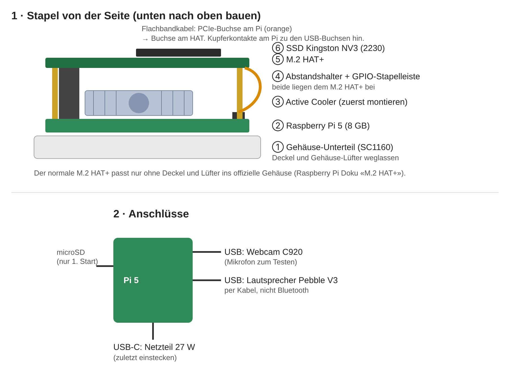

# Schnellstart: SeniorVoice auf dem Raspberry Pi aufsetzen

Status: Entwurf vom 17.11.2026, am Gerät noch nicht durchgespielt. Wer es zum ersten Mal macht: Abweichungen und Screenshots bitte direkt hier ergänzen (Stellen mit 📷).

Ziel: In etwa einer Stunde läuft SeniorVoice auf dem Pi. Du hebst per Tastatur «ab», sprichst in die Webcam und hörst die Antwort aus dem Lautsprecher. Hörer, Gabel und Knöpfe kommen später dazu, siehe [inbetriebnahme-telefon.md](inbetriebnahme-telefon.md).

---

## 0. Das brauchst du

| Teil | Hinweis |
|---|---|
| Raspberry Pi 5 (8 GB) | |
| Netzteil 27 W (offiziell, USB-C) | anderes Netzteil = Warnung «Undervoltage» |
| Active Cooler | |
| M.2 HAT+ (der normale, nicht «Compact») | mit Abstandshaltern und GPIO-Stapelleiste in der Packung |
| SSD Kingston NV3 1 TB, Grösse 2230 | |
| Gehäuse SC1160 | nur das Unterteil wird gebraucht (siehe Schritt 1) |
| Webcam Logitech C920 | dient vorerst als Mikrofon |
| Lautsprecher Creative Pebble V3 | per USB-Kabel, **nicht** per Bluetooth |
| **microSD-Karte** (16–32 GB) und Kartenleser am Laptop | nur für den allerersten Start |
| Laptop im selben WLAN wie der Pi | |

## 1. Zusammenbauen (Strom noch nicht einstecken)



1. **Active Cooler** auf den Pi klemmen und sein Kabel in die Buchse «FAN» stecken.
2. **Abstandshalter** mit den kurzen Schrauben am Pi festschrauben.
3. **GPIO-Stapelleiste** fest auf die 40 Stifte des Pi drücken.
4. **Flachbandkabel** in die PCIe-Buchse am Pi: Klemme an beiden Seiten hochziehen, Kabel einschieben (Kupferkontakte zeigen zu den USB-Buchsen), Klemme runterdrücken.
5. **M.2 HAT+** auf die Abstandshalter setzen, festschrauben, Flachbandkabel in die Buchse am HAT stecken (Kupferkontakte zeigen nach oben).
6. **SSD** schräg in den Steckplatz schieben, flach drücken, mit der Rändelschraube sichern (nicht fest anknallen).
7. Alles ins **Gehäuse-Unterteil** legen. **Deckel und Gehäuse-Lüfter weglassen:** Mit dem normalen M.2 HAT+ passen sie laut Raspberry Pi nicht (gekühlt wird über den Active Cooler).

📷 Foto vom fertigen Stapel ergänzen.

## 2. microSD-Karte am Laptop vorbereiten

1. **Raspberry Pi Imager** installieren: https://www.raspberrypi.com/software/
2. Im Imager wählen:
   - Gerät: **Raspberry Pi 5**
   - Betriebssystem: **Raspberry Pi OS (other) → Raspberry Pi OS Lite (64-bit)** (ohne Desktop; sonst blockiert der Desktop später die Audiogeräte)
   - Speicher: die microSD-Karte
3. Bei der Frage nach **Anpassungen / Einstellungen** genau das eintragen:

| Einstellung | Wert |
|---|---|
| Hostname | `seniorvoice` |
| Benutzername | **`pi`** (der Autostart-Dienst erwartet genau diesen Namen) |
| Passwort | eigenes, im Team-Passwortspeicher ablegen, nicht ins Repo |
| WLAN | Name und Passwort eures WLANs, Land **CH** |
| Zeitzone / Tastatur | Europe/Zurich / ch |
| SSH | **einschalten** (mit Passwort) |

4. Schreiben lassen, Karte auswerfen.

📷 Screenshot der Einstellungen im Imager ergänzen.

## 3. Erster Start

1. microSD in den Pi stecken, Webcam und Pebble an die **blauen USB-Buchsen** (USB 3) stecken, zuletzt das **Netzteil**.
2. 2–3 Minuten warten. Dann am Laptop im Terminal:
   ```bash
   ssh pi@seniorvoice.local
   ```
   Klappt `seniorvoice.local` nicht: IP-Adresse des Pi im Router nachschauen und `ssh pi@<IP>` verwenden.
3. System aktualisieren (dauert einige Minuten):
   ```bash
   sudo apt update && sudo apt full-upgrade -y
   sudo rpi-eeprom-update -a
   sudo reboot
   ```

**Das solltest du sehen:** Nach dem Neustart kommst du wieder per `ssh` hinein, und `lsblk` zeigt eine Zeile `nvme0n1` mit etwa 931 G. Fehlt sie: Flachbandkabel prüfen (Schritt 1.4 und 1.5).

## 4. System auf die SSD umziehen

Die SSD ist viel schneller als die microSD (wichtig für die Sprachmodelle).

```bash
sudo apt install -y git
git clone https://github.com/geerlingguy/rpi-clone.git /tmp/rpi-clone
sudo cp /tmp/rpi-clone/rpi-clone /tmp/rpi-clone/rpi-clone-setup /usr/local/sbin/
sudo rpi-clone nvme0n1      # Fragen mit "yes" bestätigen; ALLES auf der SSD wird überschrieben
```

Danach `sudo shutdown now`, **Strom ziehen, microSD herausnehmen**, Strom wieder einstecken. Ohne Karte startet der Pi 5 von der SSD.

**Das solltest du sehen:** `findmnt /` zeigt `/dev/nvme0n1p2`.

Hinweis: `rpi-clone` ist ein verbreitetes Hilfsprogramm, nicht von Raspberry Pi selbst. Klappt der Umzug nicht, kann man vorerst von der microSD weiterarbeiten; es geht nur langsamer.

## 5. SeniorVoice installieren

Alles als Benutzer `pi`, im SSH-Fenster:

```bash
# Programme
sudo apt install -y python3-venv python3-lgpio alsa-utils libportaudio2 git

# Code
git clone https://github.com/husse786/seniorvoice.git ~/seniorvoice
cd ~/seniorvoice
python3 -m venv --system-site-packages .venv
. .venv/bin/activate
pip install -r pipeline/requirements.txt piper-tts

# Sprachmodell (lokal, nichts geht ins Internet)
curl -fsSL https://ollama.com/install.sh | sh
ollama pull gemma3:1b

# Stimme
mkdir -p ~/.local/share/piper-voices && cd ~/.local/share/piper-voices
wget https://huggingface.co/rhasspy/piper-voices/resolve/main/de/de_DE/thorsten/medium/de_DE-thorsten-medium.onnx
wget https://huggingface.co/rhasspy/piper-voices/resolve/main/de/de_DE/thorsten/medium/de_DE-thorsten-medium.onnx.json
```

**Das solltest du sehen:** `ollama list` zeigt `gemma3:1b`, und `ls ~/.local/share/piper-voices` zeigt zwei Dateien.

## 6. Mikrofon und Lautsprecher einstellen

```bash
aplay -l
```
Suche die Zeile des Pebble-Lautsprechers, z. B. `card 2: V3 [Creative Pebble V3] …`. Das Wort direkt nach der Nummer (hier `V3`) ist der **Kartenname**.

Ton testen (Kartenname einsetzen):
```bash
speaker-test -D plughw:CARD=V3,DEV=0 -c 2 -t sine -f 440 -l 1
```

Dann die Einstellungsdatei anlegen:
```bash
cd ~/seniorvoice
cp .env.example .env
nano .env
```
Am Ende der Datei diese Zeilen ergänzen (Kartenname anpassen) und mit Ctrl+O, Enter, Ctrl+X speichern:
```
AUDIO_DEVICE_NAME=C920
HANDSET_ALSA_DEVICE=plughw:CARD=V3,DEV=0
SPEAKER_ALSA_DEVICE=plughw:CARD=V3,DEV=0
```
Vorerst übernimmt der Pebble beide Rollen (Hörer und Raumlautsprecher), bis der Hörer da ist. Kommentare in `.env` immer auf eine eigene Zeile schreiben, nie hinter einen Wert.

## 7. Ausprobieren

```bash
cd ~/seniorvoice/pipeline
. ../.venv/bin/activate
set -a; . ../.env; set +a
python core_service.py
```

| Du tippst | Das passiert |
|---|---|
| `a` + Enter | «Hörer abheben»: Signalton, Begrüssung aus dem Lautsprecher. Jetzt in Richtung Webcam sprechen, z. B. «Welcher Tag ist heute?» |
| `heute` | Datum und Termine von heute |
| `hilfe` | Hilfe-Ablauf mit Test-Kanal (es wird nichts verschickt) |
| `h` | auflegen |
| Ctrl+C | beenden |

Die erste Antwort kann länger dauern, weil die Modelle geladen werden. Gesprächstext wird nie gespeichert oder geloggt.

📷 Screenshot vom Terminal beim ersten Gespräch ergänzen.

## 8. Wenn etwas nicht geht

| Problem | Lösung |
|---|---|
| `ssh: Could not resolve hostname` | IP im Router suchen, `ssh pi@<IP>` |
| `nvme0n1` fehlt bei `lsblk` | Strom aus, beide Enden des Flachbandkabels neu einstecken |
| Kein Ton | `aplay -l` erneut prüfen, Kartenname in `.env` richtig? Lautstärke am Pebble aufdrehen |
| «No input device matching C920» | Webcam an andere USB-Buchse, `python -c "import sounddevice as sd; print(sd.query_devices())"` zeigt die Namen |
| `aplay: Device or resource busy` | Es wurde das Desktop-Image installiert. Lite-Image verwenden (Schritt 2) |
| `piper: not found` | venv nicht aktiv: `. ~/seniorvoice/.venv/bin/activate` |
| Sehr langsame Antworten | `findmnt /` prüfen: läuft das System noch von der microSD? |

Weitere Fehler und alles zur Telefon-Hardware: [inbetriebnahme-telefon.md](inbetriebnahme-telefon.md), Kapitel 5.

## Was danach kommt

- Hörer, Gabel und sechs Knöpfe anschliessen, Autostart einrichten: [inbetriebnahme-telefon.md](inbetriebnahme-telefon.md)
- Welche Teile dafür noch fehlen: Einkaufsliste auf der Status-Webseite (Abschnitt «Einkauf»)
