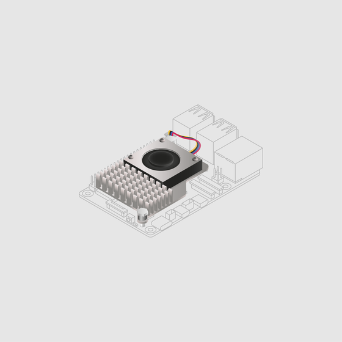
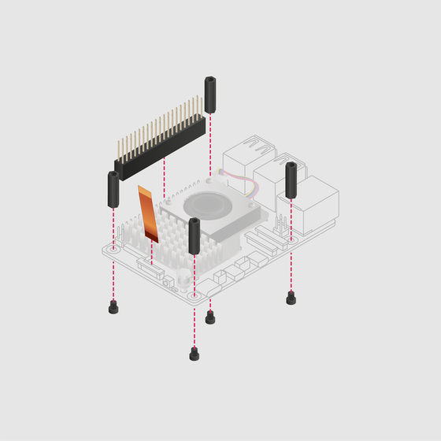
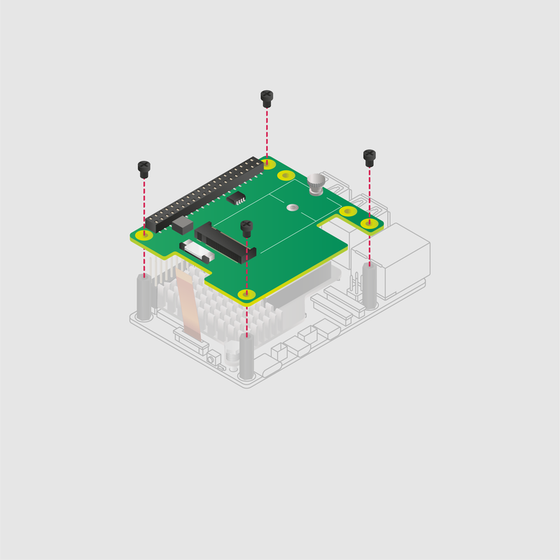
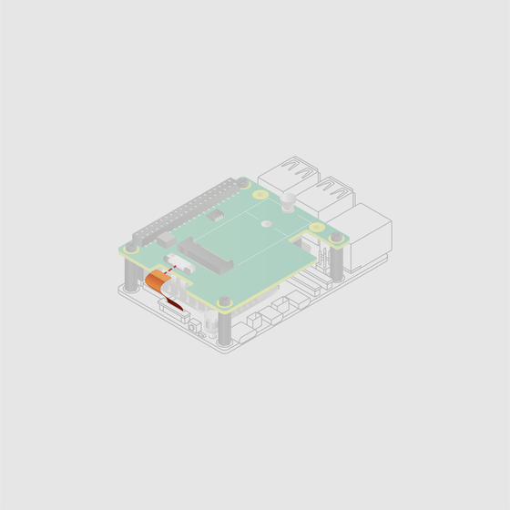
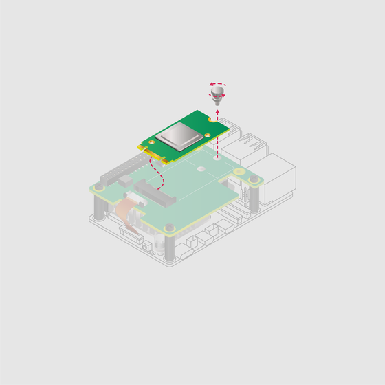
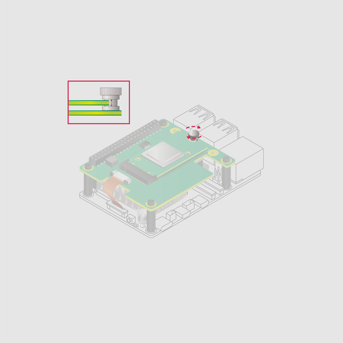
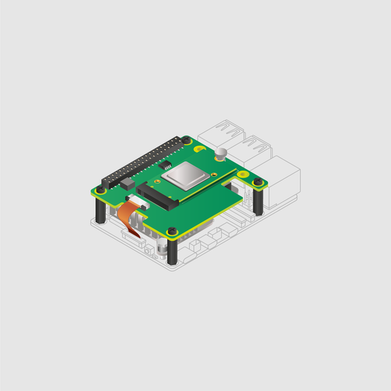

# Schnellstart: SeniorVoice auf dem Raspberry Pi aufsetzen

Status: Entwurf vom 17.11.2026, am Gerät noch nicht durchgespielt. Wer es zum ersten Mal macht: Abweichungen und Screenshots bitte direkt hier ergänzen (Stellen mit 📷, Liste am Ende).

Ziel: In etwa einer Stunde läuft SeniorVoice auf dem Pi. Du hebst per Tastatur «ab», sprichst in die Webcam und hörst die Antwort. Das ist ein **erster Teilaufbau** mit den Teilen, die schon da sind. Weitere Teile kommen dazu, sobald sie gekauft sind (Abschnitt [Erweiterungen](#erweiterungen-wenn-weitere-teile-da-sind)). Richtschnur ist das Konzept, nicht die gerade vorhandene Hardware: Was fehlt, steht auf der Einkaufsliste (Status-Webseite, Abschnitt «Einkauf»).

---

## 0. Das brauchst du

**Geliefert (Stand 17.11.2026):**

| Teil | Wofür jetzt |
|---|---|
| Raspberry Pi 5 (8 GB) | Gerät |
| Netzteil 27 W (offiziell, USB-C, SC1157) | anderes Netzteil = Warnung «Undervoltage» |
| Gehäuse SC1160 mit Lüfter | Kühlung im Zwischenaufbau (Deckel **mit** Lüfter verwenden) |
| Webcam Logitech C920 | Mikrofon (die Webcam hat **keinen** Lautsprecher) |
| M.2 HAT+ (normale Ausführung) und SSD Kingston NV3 1 TB (2230) | **noch beiseitelegen**, siehe [Erweiterung A](#a-ssd-einbauen-sobald-ein-active-cooler-da-ist) |

**Zusätzlich nötig, nicht bestellt:**

| Teil | Hinweis |
|---|---|
| **microSD-Karte** (16–32 GB) und Kartenleser am Laptop | für das Betriebssystem, bis die SSD eingebaut ist |
| **Irgendein Tonausgang zum Testen**: USB-Headset, USB-Lautsprecher, oder ein Bildschirm mit eingebauten Lautsprechern plus Micro-HDMI-Kabel | Der Pi 5 hat **keine** Kopfhörerbuchse. Ein Bluetooth-Gerät geht im Lite-System nicht einfach. Der eingebaute Raumlautsprecher kommt später (Erweiterung B). |
| Laptop im selben WLAN wie der Pi | für SSH |

### Warum ein Zwischenaufbau?

Der Pi braucht unter Last (Spracherkennung und Sprachmodell) eine Kühlung, sonst wird er heiss und bremst sich selbst. Mit dem, was da ist, gibt es genau eine sichere Kombination: **Pi im geschlossenen Gehäuse SC1160 mit dessen Lüfter**. Das normale M.2 HAT+ passt laut Raspberry Pi aber **nur ohne Deckel und ohne Gehäuselüfter** ins Gehäuse, und dann fehlt die Kühlung. Darum laufen wir vorerst von der microSD und bauen HAT und SSD erst ein, wenn ein **Active Cooler** da ist (steht auf der Einkaufsliste, ca. CHF 5–10). Das System wird dann einfach auf die SSD kopiert; nichts muss neu installiert werden.

> Quelle: Raspberry Pi Doku «M.2 HAT+»: «the M.2 HAT+ is only compatible with the Raspberry Pi Case for Raspberry Pi 5 if you remove the lid and the included fan» (Kopie: `docs/hardware/M.2 HAT+ - Raspberry Pi Documentation.pdf`).

## 1. Zusammenbauen (Strom noch nicht einstecken)

1. Pi ins **Gehäuse-Unterteil** legen.
2. Das **Lüfterkabel** des Gehäuses in die kleine 4-polige Buchse **«FAN»** auf dem Pi stecken (Aufdruck «FAN» auf der Platine, in der Ecke zwischen GPIO-Leiste und USB-Buchsen). Der Stecker passt nur in einer Richtung.
3. Lüfter-Rahmen und **Deckel** aufsetzen.

📷 Foto vom geschlossenen Gehäuse mit gestecktem Lüfterkabel ergänzen.

Das M.2 HAT+ und die SSD bleiben in der Packung.

## 2. microSD-Karte am Laptop vorbereiten

1. **Raspberry Pi Imager** installieren: https://www.raspberrypi.com/software/
2. Im Imager wählen:
   - Gerät: **Raspberry Pi 5**
   - Betriebssystem: **Raspberry Pi OS (other) → Raspberry Pi OS Lite (64-bit)** (ohne Desktop; sonst blockiert der Desktop später die Audiogeräte)
   - Speicher: die microSD-Karte
3. Bei der Frage nach **Anpassungen / Einstellungen** genau das eintragen:

| Einstellung | Wert |
|---|---|
| Hostname | `seniorvoice` |
| Benutzername | **`pi`** (der Autostart-Dienst erwartet genau diesen Namen) |
| Passwort | eigenes, im Team-Passwortspeicher ablegen, nicht ins Repo |
| WLAN | Name und Passwort eures WLANs, Land **CH** |
| Zeitzone / Tastatur | Europe/Zurich / ch (die Zeitzone ist wichtig für Erinnerungen) |
| SSH | **einschalten** (mit Passwort) |

4. Schreiben lassen, Karte auswerfen.

📷 Screenshots ergänzen: (a) Auswahl Gerät/OS/Speicher, (b) Seite mit Hostname und Benutzer, (c) Seite mit SSH.

## 3. Erster Start

1. microSD in den Pi stecken (Steckplatz unten am Pi).
2. **Webcam** an eine **blaue USB-Buchse** (USB 3) stecken. **Tonausgang** anschliessen: USB-Headset oder USB-Lautsprecher an die zweite blaue Buchse, oder Bildschirm per Micro-HDMI an **HDMI0** (die Buchse neben dem USB-C-Strom).
3. Zuletzt das **Netzteil** einstecken.
4. 2–3 Minuten warten. Dann am Laptop im Terminal (Mac: «Terminal», Windows: «PowerShell»):
   ```bash
   ssh pi@seniorvoice.local
   ```
   Klappt `seniorvoice.local` nicht: IP-Adresse des Pi im Router nachschauen und `ssh pi@<IP>` verwenden.
5. System aktualisieren (dauert einige Minuten):
   ```bash
   sudo apt update && sudo apt full-upgrade -y
   sudo rpi-eeprom-update -a
   sudo reboot
   ```

**Das solltest du sehen:** Nach dem Neustart kommst du wieder per `ssh` hinein. `vcgencmd measure_temp` zeigt im Leerlauf etwa 40–55 °C, und der Gehäuselüfter läuft unter Last hörbar an.

## 4. SeniorVoice installieren

Alles als Benutzer `pi`, im SSH-Fenster. Für diesen Schritt braucht der Pi Internet (Programme, Modelle). Danach läuft alles lokal.

**Kurzweg:** Nach `git clone` (unten) erledigt `scripts/pi-einrichten.sh` die Schritte 4 und 5.3 samt Dienste, Bildschirm und Hardwareerkennung ([pi-einrichten.md](pi-einrichten.md), Schritt 0). Die Befehle hier zeigen, was dabei passiert.

```bash
# Programme
sudo apt install -y git python3-venv python3-lgpio alsa-utils libportaudio2

# Code
git clone https://github.com/husse786/seniorvoice.git ~/seniorvoice
cd ~/seniorvoice
python3 -m venv --system-site-packages .venv
. .venv/bin/activate
pip install -r pipeline/requirements.txt piper-tts

# Sprachmodell (läuft danach lokal auf dem Pi)
curl -fsSL https://ollama.com/install.sh | sh
ollama pull gemma3:1b

# Stimme
mkdir -p ~/.local/share/piper-voices && cd ~/.local/share/piper-voices
wget https://huggingface.co/rhasspy/piper-voices/resolve/main/de/de_DE/thorsten/medium/de_DE-thorsten-medium.onnx
wget https://huggingface.co/rhasspy/piper-voices/resolve/main/de/de_DE/thorsten/medium/de_DE-thorsten-medium.onnx.json
```

**Das solltest du sehen:** `ollama list` zeigt `gemma3:1b`, und `ls ~/.local/share/piper-voices` zeigt zwei Dateien.

Optional, als Kontrolle, dass der Code vollständig ist (dauert etwa eine Minute, braucht keine Hardware):
```bash
cd ~/seniorvoice && . .venv/bin/activate
pip install -r requirements-dev.txt && pytest -q
```
Erwartet: alle Tests «passed» (Stand 17.11.: 263).

## 5. Mikrofon und Tonausgang einstellen

### 5.1 Tonausgang finden

```bash
aplay -l
```
Die Liste zeigt Zeilen wie `card 2: Headset [USB Headset], device 0: …`. Das Wort direkt nach der Nummer (hier `Headset`) ist der **Kartenname**. Den Namen deines Geräts notieren.

**USB-Headset oder USB-Lautsprecher** (Kartenname einsetzen):
```bash
speaker-test -D plughw:CARD=Headset,DEV=0 -c 2 -t sine -f 440 -l 1
```
Dein Gerätewert ist dann `plughw:CARD=<Kartenname>,DEV=0`.

**Bildschirm über HDMI:** Hier geht `plughw` nicht. Stattdessen:
```bash
aplay -L | grep -i hdmi            # zeigt z. B. hdmi:CARD=vc4hdmi0,DEV=0
speaker-test -D hdmi:CARD=vc4hdmi0,DEV=0 -c 2 -t sine -f 440 -l 1
```
Dein Gerätewert ist dann die gezeigte `hdmi:…`-Zeile. (Unsicher: am Gerät noch nicht geprüft. Hörst du nichts, Lautstärke am Bildschirm prüfen und Kabel an der anderen HDMI-Buchse versuchen, dann `vc4hdmi1`.)

Ein Pfeifton von etwa einer Sekunde heisst: richtig.

### 5.2 Mikrofon prüfen

```bash
arecord -l                                     # die Webcam erscheint als "C920"
arecord -D plughw:CARD=C920,DEV=0 -f S16_LE -r 16000 -c 1 -d 5 /tmp/t.wav
aplay -D <dein Gerätewert> /tmp/t.wav          # eigene Stimme hören
rm /tmp/t.wav
```
Heisst die Karte bei `arecord -l` anders als `C920`, diesen Namen einsetzen.

### 5.3 Einstellungsdatei anlegen

```bash
cd ~/seniorvoice
cp .env.example .env
nano .env
```
Am Ende der Datei diese Zeilen ergänzen (Gerätewert aus 5.1 einsetzen) und mit Ctrl+O, Enter, Ctrl+X speichern:
```
AUDIO_DEVICE_NAME=C920
HANDSET_ALSA_DEVICE=plughw:CARD=Headset,DEV=0
SPEAKER_ALSA_DEVICE=plughw:CARD=Headset,DEV=0
```
Vorerst übernimmt ein Gerät beide Rollen (Hörer und Raumlautsprecher), bis Hörer und Lautsprecher da sind. Kommentare in `.env` immer auf eine eigene Zeile schreiben, nie hinter einen Wert.

## 6. Ausprobieren

```bash
cd ~/seniorvoice/pipeline
. ../.venv/bin/activate
set -a; . ../.env; set +a
python core_service.py
```

| Du tippst (dann Enter) | Das passiert |
|---|---|
| `a` | «Hörer abheben»: Signalton, Begrüssung. Jetzt in Richtung Webcam sprechen, z. B. «Welcher Tag ist heute?» |
| `heute` | Datum und Termine von heute |
| `kalender` | Termine der nächsten 7 Tage |
| `hilfe` | Hilfe-Ablauf mit Test-Kanal (es wird nichts verschickt, Meldung erscheint im Terminal) |
| `h` | auflegen |
| `q` oder Ctrl+C | beenden |

Die erste Antwort kann länger dauern, weil die Modelle geladen werden; beim allerersten Gespräch lädt der Pi zudem einmalig das Spracherkennungsmodell aus dem Internet. Gesprächstext wird nie gespeichert oder geloggt.

Einen Testtermin anlegen (Datum/Zeit anpassen, ein paar Minuten in der Zukunft):
```bash
python appointments_cli.py add "Testtermin" "2026-11-20 14:00" --by Test --pre 0
python appointments_cli.py list
```

📷 Screenshot vom Terminal beim ersten Gespräch ergänzen.

**Temperatur im Blick behalten** (zweites SSH-Fenster): `watch -n 2 vcgencmd measure_temp`. Bleibt sie unter etwa 80 °C, ist alles gut. `vcgencmd get_throttled` sollte `throttled=0x0` zeigen.

**Autostart noch nicht einrichten:** Der Dienst in `deploy/seniorvoice.service` startet mit Hörer und Knöpfen (`--input gpio`). Die sind noch nicht da.

## 7. Wenn etwas nicht geht

| Problem | Lösung |
|---|---|
| `ssh: Could not resolve hostname` | IP im Router suchen, `ssh pi@<IP>` |
| Kein Ton | `aplay -l` erneut prüfen, Kartenname in `.env` richtig? Lautstärke am Gerät. Bei HDMI: `hdmi:…`, nicht `plughw:…` (5.1) |
| «No input device matching C920» | Webcam an andere USB-Buchse, `python -c "import sounddevice as sd; print(sd.query_devices())"` zeigt die Namen |
| `aplay: Device or resource busy` | Es wurde das Desktop-Image installiert: Lite-Image verwenden (Schritt 2). Kommt es nur vor, wenn gleichzeitig zwei Ansagen laufen (z. B. `hilfe` mitten im Gespräch): bekannte Grenze, solange Hörer und Lautsprecher dasselbe Gerät sind |
| `piper: not found` | venv nicht aktiv: `. ~/seniorvoice/.venv/bin/activate` |
| Antworten werden immer langsamer, `get_throttled` nicht `0x0` | Pi zu warm: Deckel mit Lüfter drauf? Lüfterkabel in «FAN»? |
| Warnung «Undervoltage» | offizielles 27-W-Netzteil verwenden |

Weitere Fehler und alles zur Telefon-Hardware: [inbetriebnahme-telefon.md](inbetriebnahme-telefon.md), Kapitel 5.

---

## Erweiterungen (wenn weitere Teile da sind)

### A. SSD einbauen (sobald ein Active Cooler da ist)

Die SSD ist deutlich schneller als die microSD (FS26 gemessen: Lesen etwa 5×), das hilft beim Laden der Modelle.

**Vorher am laufenden Pi** (noch mit microSD) einmal ausführen, damit die Firmware aktuell ist: `sudo rpi-eeprom-update -a`. Dann `sudo shutdown now` und **Strom ziehen**.

Umbau (Bilder: Raspberry Pi Doku, siehe Bildnachweis):

| | |
|---|---|
|  | **1. Active Cooler** montieren: Deckel und Gehäuselüfter abnehmen, Gehäuselüfter-Kabel aus «FAN» ziehen. Schutzfolien der Wärmeleitpads abziehen, Cooler mit den zwei Druckstiften aufstecken, sein Kabel in «FAN». |
|  | **2.** Die vier **Abstandshalter** festschrauben, die **GPIO-Stapelleiste** fest auf die 40 Stifte drücken. **Flachbandkabel** in die PCIe-Buchse am Pi: Klemme an beiden Seiten hochziehen, Kabel einschieben (Kupferkontakte zeigen **zu den USB-Buchsen**), Klemme runterdrücken. |
|  | **3. M.2 HAT+** auf die Abstandshalter setzen und festschrauben. |
|  | **4.** Flachbandkabel in die Buchse am HAT (Kupferkontakte zeigen **nach oben**). |
|  | **5. SSD** leicht schräg in den Steckplatz schieben, nicht drücken. |
|  | **6.** SSD flach drücken und mit der Rändelschraube sichern (nicht fest anknallen). |
|  | **7.** Fertig. Alles ins **Gehäuse-Unterteil**, **ohne** Deckel und Gehäuselüfter. |

Übersicht von der Seite:


**Starten** (microSD bleibt noch drin) und prüfen: `lsblk` zeigt eine Zeile `nvme0n1` mit etwa 931 G. Fehlt sie: Strom aus, beide Enden des Flachbandkabels neu einstecken.

**System auf die SSD kopieren:**
```bash
git clone https://github.com/geerlingguy/rpi-clone.git /tmp/rpi-clone
sudo cp /tmp/rpi-clone/rpi-clone /tmp/rpi-clone/rpi-clone-setup /usr/local/sbin/
sudo rpi-clone nvme0n1      # Fragen mit "yes" bestätigen; ALLES auf der SSD wird überschrieben
```
Danach `sudo shutdown now`, **Strom ziehen, microSD herausnehmen**, Strom wieder einstecken. Ohne Karte startet der Pi 5 von der SSD.

**Das solltest du sehen:** `findmnt /` zeigt `/dev/nvme0n1p2`. Code, Modelle und `.env` sind mitkopiert; Schritt 6 funktioniert wie vorher.

Hinweis: `rpi-clone` ist ein verbreitetes Hilfsprogramm, nicht von Raspberry Pi selbst. Klappt der Umzug nicht, einfach mit der microSD weiterarbeiten.

### B. Raumlautsprecher

Entscheid 17.11.2026: Der Raumlautsprecher wird **ins Gehäuse eingebaut**, kabelgebunden (FS26: Bluetooth verschluckt kurze Töne). Aufbau: zweiter USB-Audio-Adapter → Verstärker PAM8403 → Lautsprecher 3 W, 4–8 Ω. Anschluss, Benennung der beiden Adapter (`handset`/`speaker`) und Prüfbefehle stehen in [inbetriebnahme-telefon.md](inbetriebnahme-telefon.md), Kapitel 2 «Audio» und 4.3–4.4. Bis dahin bleibt der Ersatz-Tonausgang aus Schritt 5.

### C. Hörer, Gabel und Knöpfe (Telefon-Hardware)

Ab hier gilt [inbetriebnahme-telefon.md](inbetriebnahme-telefon.md): zwei USB-Audio-Adapter (Hörer und Raumlautsprecher getrennt), Gabelschalter und sechs Knöpfe an der GPIO-Leiste, danach Autostart.

### Hinweis zum PIR-Bewegungssensor

Der PIR-Sensor (HC-SR501) war der Auslöser im FS26-Prototyp. Im Konzept entfällt er: Auslöser sind Gabelschalter und «Sprechen»-Knopf (`05_SOLL_Architektur.md`, Abschnitt Auslöser). Er wird für das Gerät nicht gebraucht. Nur zum Nachstellen des FS26-Modus (`python main.py`): Signal an **GPIO4 = Stift 7**, VCC an 5 V (Stift 2), GND an Stift 6 (so im FS26-Log 006 und im Datenblatt `docs/hardware/MOTIONSENSOR-HC-SR501-MANUAL-23.09.2020.pdf`). Die Angabe «GPIO17» im README ist veraltet.

### Hinweis zu 8 GB Arbeitsspeicher

Geliefert wurde der Pi mit 8 GB (FS26 hatte 16 GB). Für das Standardmodell `gemma3:1b` plus Spracherkennung `small` reicht das. Grössere Modelle (z. B. `gemma3:4b`) sind auf der CPU ohnehin zu langsam (FS26-Benchmark). Mit dem geplanten AI HAT+ 2 läuft das Sprachmodell auf dessen eigenem Speicher.

### Hinweis zum AI HAT+ 2

Das AI HAT+ 2 und das M.2 HAT+ brauchen beide den einzigen PCIe-Anschluss des Pi 5. Kommt das AI HAT+ 2, zieht die SSD in ein USB-Gehäuse um (steht im Bauplan, Einkaufsliste Nr. 2).

---

## Noch fehlende Screenshots

| Stelle | Was fotografieren / aufnehmen |
|---|---|
| Schritt 1 | geschlossenes Gehäuse, Lüfterkabel in «FAN» |
| Schritt 2 | Imager: (a) Gerät/OS/Speicher, (b) Hostname/Benutzer, (c) SSH |
| Schritt 6 | Terminal beim ersten Gespräch |
| Erweiterung A | fertiger Stapel im Gehäuse-Unterteil |

Bilder in `docs/setup/` ablegen und hier verlinken. Keine Bilder mit Passwörtern, WLAN-Namen oder Gesprächsinhalten.

## Bildnachweis

Die Bilder `setup/m2hat_*.png` stammen aus der Raspberry Pi Dokumentation «M.2 HAT+» (https://www.raspberrypi.com/documentation/accessories/m2-hat-plus.html), © Raspberry Pi Ltd, Lizenz CC BY-SA 4.0 (https://creativecommons.org/licenses/by-sa/4.0/). Verkleinert und Hintergrund weiss gesetzt. `setup/aufbau-und-anschluesse.png` ist eine eigene Skizze.
